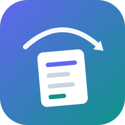
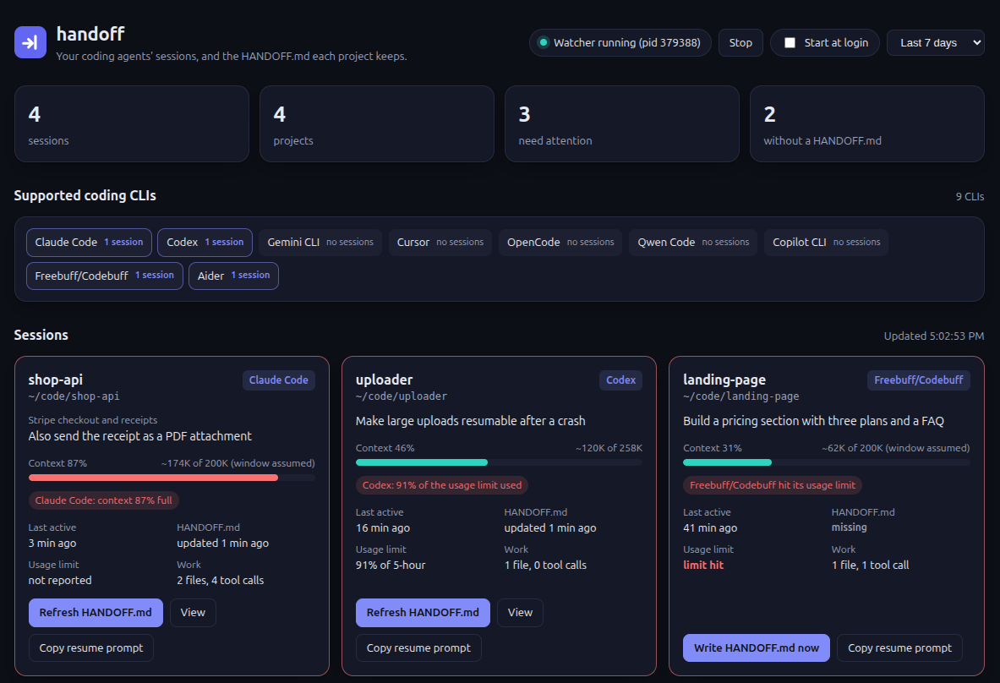

<div align="center">



# handoff

**Hit a limit in one coding CLI. Keep going in another, right where you stopped.**

`handoff` is an [Agent Skill](https://agentskills.io) for coding agents. It keeps a `HANDOFF.md` in your project with the goal, where the agent stopped, its plan, what failed, the files it changed and the state of the repo. When the context fills up, the credit runs out or the session dies, open the project in any other agent and say **"Read HANDOFF.md and continue."**

[](skills/handoff/SKILL.md)
[](#install)
[](https://www.python.org/)
[](pyproject.toml)

[Install](#install) · [Use it](#use-it) · [What it does](#what-the-skill-does) · [Session logs it reads](#session-logs-it-reads) · [Watcher and dashboard](#optional-the-watcher-and-the-dashboard) · [FAQ](#faq)



</div>

## The problem

You're deep into a task with Claude Code, and it stops: *usage limit reached*. Or Codex runs out of credit, Cursor's context is full, or the terminal crashes. The agent knew what it was doing, what it had tried and what came next, and all of that is gone. The next agent starts from zero.

**`handoff` fixes it in two ways:**

1. **The skill teaches every agent to keep a handoff.** It writes `HANDOFF.md` when the budget runs low, at milestones and when you ask, and reads it back when you say "continue", in any CLI.
2. **Its bundled script reads the agents' own session logs.** Every coding CLI saves its conversation to disk. So even when a session dies before it could write anything, the next agent can rebuild the handoff from that log: Claude Code, Codex, Cursor, Gemini CLI, Copilot CLI, OpenCode, Qwen Code, Freebuff and Aider.

## Install

You need Python 3.8 or newer and nothing else.

```bash
git clone https://github.com/chentaymane/handOff
cd handOff
python3 install.py
```

On Windows, use `python` or `py -3` instead of `python3`.

`install.py` finds the coding CLIs on your computer and copies the skill into each one's skills folder:

| Skills folder | Read by |
|---|---|
| `~/.claude/skills/handoff` | Claude Code |
| `~/.agents/skills/handoff` | Codex, Cursor, Gemini CLI, GitHub Copilot CLI, OpenCode (always installed: it's the shared folder of the Agent Skills standard) |
| `~/.qwen/skills/handoff` | Qwen Code |
| `~/.codeium/windsurf/skills/handoff` | Windsurf |
| `~/.gemini/antigravity/skills/handoff` | Antigravity |
| `~/.config/agents/skills`, `~/.config/goose/skills`, `~/.factory/skills`, `~/.kiro/skills`, ... | Amp, Goose, Factory Droid, Kiro CLI, Crush, Kilo Code, Roo Code, Augment, Trae, Continue, Junie, OpenHands |

It only installs where the CLI is present, never overwrites a different skill that happens to be called `handoff`, and running it again updates every copy. `python3 install.py --dry-run` shows what it would do, `python3 install.py status` shows where it is.

<details>
<summary><b>Other ways to install</b></summary>

| Where | How |
|---|---|
| **Any CLI, straight from GitHub** | `npx skills add chentaymane/handOff` (the open-source [`skills`](https://github.com/vercel-labs/skills) installer; add `-g` for all projects, `-a claude-code -a codex` to pick agents) |
| **Claude Code plugin** | `/plugin install handoff --marketplace chentaymane/handOff`, or `/plugin marketplace add chentaymane/handOff` then `/plugin install handoff@handoff`. As a plugin, the skill is called `/handoff:handoff`. |
| **Gemini CLI** | `gemini skills install https://github.com/chentaymane/handOff --path skills/handoff` |
| **One project, for your whole team** | copy `skills/handoff` into the repo's `.agents/skills/` and `.claude/skills/` and commit it |
| **claude.ai or a skill marketplace** | `python3 install.py zip` writes `handoff-skill.zip`, ready to upload. Uploaded skills run in a sandbox without your session logs, so there the writing and resuming work and log recovery finds nothing. |
| **Aider** (no skills support) | `aider --read ~/.agents/skills/handoff/SKILL.md` |
| **Freebuff / Codebuff** (no skills support) | say "Read ~/.agents/skills/handoff/SKILL.md and follow it" |

</details>

## Use it

Just work as usual. The skill loads by itself when it's needed, or you can ask for it:

| You say | The agent |
|---|---|
| "save progress", "write a handoff", "tokens almost finished", "I'm switching to Codex" | writes or updates `HANDOFF.md` |
| "continue", "read the handoff", "pick up where we left off" | reads `HANDOFF.md`, checks it against git, and carries on |
| "my last session hit the limit, recover it" | finds that session's log, from any CLI, and rebuilds the handoff from it |

Agents also write it on their own: when the context or usage budget runs low, right after a request fails on a limit, and at milestones of long tasks.

Calling it by name: `/handoff` in Claude Code, Cursor, Copilot CLI and Qwen Code, `$handoff` in Codex, `/skills` to list skills in Gemini CLI. Anywhere else, ask for "the handoff skill". [`references/clis.md`](skills/handoff/references/clis.md) has the details for each CLI.

## What the skill does

The skill is [`skills/handoff/SKILL.md`](skills/handoff/SKILL.md) plus a script, `scripts/handoff.py`, that the agent runs.

- **Write:** the agent writes the parts only it knows (goal, where it stopped, next steps, decisions, what failed) from a fixed template, then runs `handoff.py now --tool <its CLI>`, which adds the facts from its own session log and git.
- **Resume:** read `HANDOFF.md`, compare it with `git status` and `git log`, summarize in two lines, continue from "Next steps".
- **Recover:** `handoff.py sessions` lists the project's recent sessions from every CLI. `handoff.py now --from LOG --print` turns the one that died into a digest, and the agent writes the handoff from it, saying which parts are reconstructed.
- **Spread:** `handoff.py skill install` copies the skill into your other CLIs.

### What goes into HANDOFF.md

The agent's own sections come first, then an auto section between two marker lines that the script rewrites; everything outside the markers is kept.

| Section | What it contains |
|---|---|
| **Goal**, **Where we stopped**, **Next steps** | written by the agent: concrete paths, commands, exact errors |
| **Decisions**, **Tried and failed**, **Key files**, **How to run** | written by the agent, so the next one doesn't undo or repeat them |
| **Heads-up** (auto) | limit hit, usage at 91%, context 87% full |
| **Goal** and **Where we stopped** (auto) | your first and latest request, the agent's last message and its own recap |
| **Plan** (auto) | the agent's to-do list, with done and in-progress items marked |
| **Files changed** (auto) | from the agent's edits *and* from the commits it made, so changes made through shell commands aren't missed |
| **Recent commands**, **Errors seen** (auto) | what it ran, and what failed |
| **Session** (auto) | tool, model, context used, usage limit and reset time, path to the full log |
| **Repo** (auto) | branch, commit, ahead/behind, uncommitted files, commits made during the session |

<details>
<summary><b>See an example</b>: the auto section of a Codex session at 91% of its usage limit</summary>

```markdown
<!-- handoff:auto:start -->
## Auto handoff

_Last update: 2026-09-16 15:42 +0100, from a **Codex** session (gpt-5.5)._

**Heads-up:** 91% of the usage limit is used.

### Goal
> Add Stripe checkout to the cart page and email a receipt after payment

### Where we stopped
> Checkout works end to end in test mode. The receipt email is wired up,
> but the template still has placeholder text.

### Plan
- [x] Create the checkout session endpoint
- [x] Redirect the cart page to Stripe
- [ ] **Send the receipt email** _(in progress)_
- [ ] Handle failed payments

### Files changed in this session
- `src/routes/checkout.ts` - added
- `src/pages/cart.tsx` - edited
- `src/emails/receipt.html` - added

### Recent commands
- `npm test -- checkout`

### Session
- **Tool:** Codex (gpt-5.5), 48 tool calls
- **Context:** ~142K of 258K tokens (55%)
- **Usage limit:** 91% used of the 5-hour window, resets 2026-09-16 17:30

### Repo
- **Branch:** `feature/checkout` @ `4be21c9` - Add checkout session endpoint
- **Uncommitted:** 3 changed, 1 untracked
<!-- handoff:auto:end -->
```

</details>

## Session logs it reads

The skill works in any CLI that reads Agent Skills. The script can also read the session logs of these nine, which is what makes recovery and the auto section possible:

| CLI | Where it reads | Context | Usage limit | Tested |
|---|---|---|---|---|
| **Claude Code** (CLI, desktop, VS Code, JetBrains) | `~/.claude/projects` | measured | when a limit is hit | ✅ real sessions |
| **Codex** (CLI, IDE extension, app) | `~/.codex/sessions` | exact | **% used before you hit it**, with reset time | ✅ real sessions |
| **Cursor** | `~/.cursor` transcripts and `state.vscdb` | exact | when a limit is hit | ✅ real sessions |
| **OpenCode** | `~/.local/share/opencode/opencode.db` | measured | when a limit is hit | ✅ real sessions |
| **Gemini CLI** | `~/.gemini/tmp/*/chats` | measured | when a quota is hit | 🧪 sample logs |
| **Qwen Code** | `~/.qwen/tmp/*/chats` | measured | when a limit or quota is hit | 🧪 sample logs |
| **GitHub Copilot CLI** | `~/.copilot/session-state` | when logged | when a rate limit is hit | 🧪 sample logs |
| **Freebuff** / **Codebuff** | `~/.config/manicode/projects` | measured | when credits run out | 🧪 sample logs |
| **Aider** | `.aider.chat.history.md` in each project | from its token report | when a rate limit is hit | 🧪 sample logs |

✅ tested on real sessions. 🧪 built from the tool's source code or published log format and tested on sample logs; please [open an issue](https://github.com/chentaymane/handOff/issues) if one misreads your sessions.

In other CLIs (Windsurf, Goose, Amp, Kiro and so on) the skill still writes and resumes handoffs; the script adds only the repo facts there (`now --repo-only`).

## Optional: the watcher and the dashboard

A skill only runs while the agent is alive and remembers to use it, and a usage limit can end a session mid-step. For that case, the same script includes a small background watcher. It reads the logs of all nine CLIs every 5 seconds and refreshes each project's `HANDOFF.md` after every step, with a desktop alert when a limit hits, so the handoff is already there when a session dies.

```bash
python3 skills/handoff/scripts/handoff.py install
```

This adds a `handoff` command, starts the watcher, and starts it at every login. The skill offers it to you when it would help, and only runs it if you say yes.

When it writes:

- **After every step:** when an agent has been quiet for 20 seconds, it just finished a step, so `HANDOFF.md` is at most one step behind.
- **Right away, with a desktop alert,** when a limit or quota is hit, credits run out, the context passes 70% or 85%, or Codex's usage passes 80% or 95%.
- **Only for real work:** at least one changed file, three commands, two requests, or a limit hit; and only for sessions active after the watcher started.
- **Never** in your home folder, a drive root, temp folders or agents' settings folders. An empty `.nohandoff` file keeps a project out too.

`handoff dashboard` opens a local page at `http://127.0.0.1:7788` with one card per project: which CLI, the goal, a context bar, the usage limit, alerts, how old its `HANDOFF.md` is, and buttons to write it now or copy the prompt that resumes the work elsewhere. It's served from your computer only and refuses requests from other websites.

## Commands

Run them as `python3 skills/handoff/scripts/handoff.py COMMAND` from the clone (or from any installed copy of the skill), or as `handoff COMMAND` after `handoff.py install`.

| Command | What it does |
|---|---|
| `skill install` / `uninstall` / `status` | Copy the skill into every coding CLI found, remove it, or show where it is (`--only claude,agents`, `--dry-run`) |
| `skill zip` | Package the skill as `handoff-skill.zip` for uploading |
| `now` | Write the auto section of `HANDOFF.md` for this folder from its latest session (`--print` to only show it) |
| `now --tool AGENT` | ... from this folder's latest session of one CLI: `claude`, `codex`, `cursor`, `gemini`, `opencode`, `qwen`, `copilot`, `codebuff`, `aider` |
| `now --repo-only` | ... with git facts only |
| `now --from LOG` | ... from one specific session log |
| `sessions` | This folder's recent sessions from every CLI, with their log paths |
| `status` | Recent sessions on this computer: context, usage limit, `HANDOFF.md` age |
| `install` / `uninstall` | Set up or remove the watcher, the `handoff` command and start at login (your `HANDOFF.md` files are kept) |
| `dashboard` | Open the dashboard (`--port 7788`, `--no-open`) |
| `start` / `stop` / `watch` / `autostart on\|off` | Control the watcher by hand |

## Privacy and safety

- **Nothing leaves your computer.** No account, no network calls, no telemetry. It reads files and writes files.
- **Secrets are masked** before writing: `sk-`, `ghp_`, `AKIA`, `AIza` and `xox` keys, JWTs, `password=`-style values, and credentials in URLs. The skill also tells agents never to write secrets.
- **Agent data is read-only.** Databases are opened in read-only mode, so `handoff` can never block or change your agents.
- **Your notes are safe.** The script only rewrites the section between its markers.
- **The installer is careful.** It never replaces a skill folder that holds a different skill, and `uninstall` removes only its own folders.

## Configuration

Nothing is required. These environment variables are optional:

| Variable | What it does |
|---|---|
| `HANDOFF_HOME` | Where the watcher keeps its own files (default `~/.handoff`: `handoff.log`, `state.json`, `watch.pid`) |
| `HANDOFF_SCAN` | Folders to search for Aider projects, separated like `PATH` (default: your home folder and `Desktop`, `Documents`, `projects`, `code`, `src`, `dev`, `work`, `repos` and a few more, two levels deep) |
| `CODEX_HOME` | Codex's data folder, if you moved it |
| `FREEBUFF_CONFIG_DIR` | Freebuff's data folder, if you moved it |

## FAQ

<details>
<summary><b>Is it a skill or an app?</b></summary>

A skill first: `skills/handoff` is a standard Agent Skill folder (`SKILL.md`, `scripts/`, `references/`) that any CLI supporting skills can load, and it's self-contained, so copying the folder is all an install is. The background watcher is an optional extra inside the same script, for sessions that end before the agent can act.
</details>

<details>
<summary><b>Why does the skill need Python?</b></summary>

Only for its script, which reads session logs and git. Without Python, the agent still writes and resumes `HANDOFF.md` from the instructions in `SKILL.md`, and adds the repo state from `git status` itself.
</details>

<details>
<summary><b>Cursor or OpenCode shows the skill twice.</b></summary>

They read both `~/.claude/skills` and `~/.agents/skills`, and the installer puts a copy in each so Claude Code and the others all get it. Both copies are the same. To keep one, run `python3 install.py uninstall --only claude` (Claude Code then loses it) or ignore the duplicate.
</details>

<details>
<summary><b>Why does only Codex show a usage percentage?</b></summary>

Because only Codex writes it into its logs. Claude Code, Cursor and the others only say something once the limit is hit. For them the skill writes checkpoints as it goes, and the watcher, if you use it, refreshes the file after every step.
</details>

<details>
<summary><b>Should I commit HANDOFF.md?</b></summary>

Your choice. Committing it lets a teammate or another machine pick up the work. If you'd rather not, add `HANDOFF.md` to `.gitignore`; `handoff` doesn't count it as an uncommitted change either way.
</details>

<details>
<summary><b>The context percentage for Claude Code says "window size assumed". Why?</b></summary>

Claude Code logs how many tokens are in use, but not how big the window is. `handoff` assumes 200K, and 1M once a session goes past 200K or the model name ends in `[1m]`.
</details>

## Add another CLI

Each CLI the script reads has one reader in [`skills/handoff/scripts/handoff/sources/`](skills/handoff/scripts/handoff/sources) with the same three functions:

```python
def discover(max_age_hours):  # yield (ref, stamp) for each session; stamp changes whenever the session does
def read(ref):                # return a Session: requests, replies, plan, files, commands, errors, tokens, limits
def folder(ref):              # the session's project folder, found cheaply
```

Add the module to `MODULES` in [`sources/__init__.py`](skills/handoff/scripts/handoff/sources/__init__.py) and a test with a small sample log, and it shows up everywhere. To install the skill into another CLI's skills folder, add a line to `TARGETS` in [`skill.py`](skills/handoff/scripts/handoff/skill.py).

```bash
python3 -m unittest discover -s tests -t .
```

## Releasing a new version

The version lives in four places, and the tests fail if they disagree: `skills/handoff/SKILL.md` (`metadata.version`), `skills/handoff/scripts/handoff/__init__.py`, `.claude-plugin/plugin.json` and `pyproject.toml`. Then run `claude plugin validate .` for the Claude Code marketplace, and `python3 install.py zip` for an upload package.

## Uninstall

```bash
python3 install.py uninstall
```

This removes the skill from every CLI's skills folder. If you set up the watcher, `handoff uninstall` stops it, turns off autostart and removes the `handoff` command. Your `HANDOFF.md` files stay.
