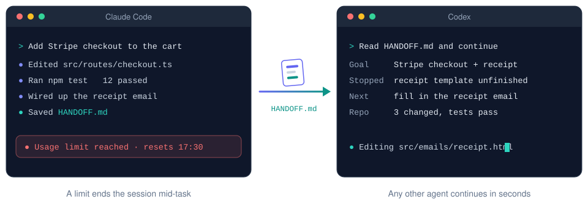
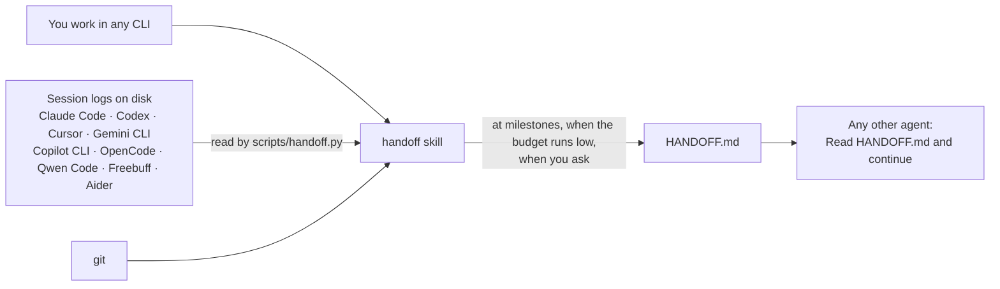

<div align="center">


# handoff

### Your coding agent hit a limit. The next one picks up exactly where it stopped.

An [Agent Skill](https://agentskills.io) that keeps a `HANDOFF.md` in your project: the goal, where the agent stopped, what comes next and what already failed. When a session dies before it can write one, handoff rebuilds it from the session's own log. It works in Claude Code, Codex, Cursor, Gemini CLI, Copilot CLI, OpenCode and 15 more.

[](CHANGELOG.md)
[](https://github.com/chentaymane/handOff/actions/workflows/tests.yml)
[](LICENSE)
[](skills/handoff/SKILL.md)
[](pyproject.toml)

[Install](#install) · [Use it](#use-it) · [Why handoff](#why-handoff) · [Supported CLIs](#supported-clis) · [FAQ](#faq)

<br>



</div>

## Install

**macOS and Linux**

```bash
curl -fsSL https://raw.githubusercontent.com/chentaymane/handOff/main/install.sh | sh
```

**Windows** (PowerShell)

```powershell
irm https://raw.githubusercontent.com/chentaymane/handOff/main/install.ps1 | iex
```

One command finds every coding CLI on your computer and installs the skill into each one. It needs Python 3.8 or newer, and nothing else. Run the same command again to update.

```
handoff skill 2.1.0

  Claude Code                                       ~/.claude/skills/handoff   installed
  Codex, Cursor, Gemini CLI, Copilot CLI, OpenCode  ~/.agents/skills/handoff   installed
  Qwen Code                                         ~/.qwen/skills/handoff     installed

Done. Open a new session in any of these CLIs and say "save progress" or "continue".
```

<details>
<summary><b>Install from inside your CLI instead</b></summary>

<br>

| CLI | Command |
|---|---|
| **Claude Code** | `/plugin install handoff --marketplace chentaymane/handOff` <br><sub>or `/plugin marketplace add chentaymane/handOff`, then `/plugin install handoff@handoff`</sub> |
| **GitHub Copilot CLI** | `copilot plugin install chentaymane/handOff` |
| **Gemini CLI** | `gemini skills install https://github.com/chentaymane/handOff --path skills/handoff` |
| **Codex** | `$skill-installer install https://github.com/chentaymane/handOff/tree/main/skills/handoff` |
| **Any CLI, with Node.js** | `npx skills add chentaymane/handOff -g` |
| **From a clone** | `git clone https://github.com/chentaymane/handOff && cd handOff && python3 install.py` |
| **claude.ai, skill marketplaces** | `python3 install.py zip` builds `handoff-skill.zip` to upload |

</details>

## Use it

There is nothing to learn. Work as usual; the skill loads when it's needed, or you ask for it:

| You say | Your agent |
|---|---|
| *"save progress"*, *"write a handoff"*, *"tokens almost finished"* | writes or updates `HANDOFF.md` |
| *"I'm switching to Codex"*, *"we'll continue tomorrow"* | writes it, and tells you how to resume |
| *"continue"*, *"read the handoff"*, *"pick up where we left off"* | reads it, checks it against git, and carries on |
| *"my last session hit the limit, recover it"* | finds that session's log, in any CLI, and rebuilds the handoff from it |

It also writes the handoff on its own: when the context or usage budget runs low, the moment a request fails on a limit, and at milestones of long tasks.

To call it by name: `/handoff` in Claude Code, Cursor, Copilot CLI and Qwen Code, `$handoff` in Codex. In any other CLI, ask for "the handoff skill".

## Why handoff

You're deep into a task and the agent stops: *usage limit reached*. Or the credit runs out, the context is full, the session expires, the terminal crashes. The agent knew the goal, the plan, what it had tried and what came next. All of it is gone, and the next session starts from zero.

- **Switch tools mid-task.** Write the handoff in Claude Code, continue in Codex, Cursor or Gemini CLI. `HANDOFF.md` is plain Markdown that every agent reads.
- **Survives a session that dies.** Every CLI saves its conversation to disk. handoff reads the logs of nine of them, so even a session cut off with no warning can be turned into a handoff afterwards.
- **Facts, not guesses.** Besides what the agent writes, the handoff records the files changed (including through shell commands and commits), the commands that ran, the errors, context and usage-limit use, and the exact state of the repo.
- **Built for the next agent.** A fixed template puts the goal, where it stopped and the next steps first, with exact paths and errors instead of "the bug we found".
- **Private.** Nothing leaves your computer, and API keys and passwords are masked before anything is written.
- **No dependencies.** One folder, Python's standard library, nothing to configure.

## How it works



The skill is a standard folder, [`skills/handoff/`](skills/handoff): [`SKILL.md`](skills/handoff/SKILL.md) tells the agent when and how to write, resume and recover a handoff, and `scripts/handoff.py` does the mechanical part. The agent writes the parts only it knows, then runs the script, which adds the facts between two marker lines. Everything outside those lines is yours and is never changed.

<details>
<summary><b>See an example HANDOFF.md</b></summary>

```markdown
# HANDOFF: Stripe checkout

**Updated:** 2026-09-16 15:42 CET | **By:** Codex / gpt-5.5 | **Status:** In progress

## Goal
Add Stripe checkout to the cart page and email a receipt after payment.
Done means: test-mode payment works end to end and the receipt arrives.

## Where we stopped
Checkout works in test mode. `src/emails/receipt.html` still has placeholder
text; `sendReceipt()` in `src/routes/checkout.ts:88` is wired but untested.

## Next steps
1. Fill in the receipt template (order lines, total, support link).
2. Run `npm test -- checkout` and send a test receipt with `npm run mail:test`.
3. Handle failed payments (`payment_intent.payment_failed` webhook).

## Decisions and constraints
- Stripe Checkout, not Elements: the user wants no card form on our site.

## Tried and failed / gotchas
- The webhook secret differs per `stripe listen` session; copy it into `.env` each time.

<!-- handoff:auto:start -->
## Auto handoff

_Last update: 2026-09-16 15:42 +0100, from a **Codex** session (gpt-5.5)._

**Heads-up:** 91% of the usage limit is used.

### Files changed in this session
- `src/routes/checkout.ts` - added
- `src/pages/cart.tsx` - edited
- `src/emails/receipt.html` - added

### Session
- **Tool:** Codex (gpt-5.5), 48 tool calls
- **Context:** ~142K of 258K tokens (55%)
- **Usage limit:** 91% used of the 5-hour window, resets 2026-09-16 17:30

### Repo
- **Branch:** `feature/checkout` @ `4be21c9` - Add checkout session endpoint
- **Uncommitted:** 3 changed, 1 untracked
<!-- handoff:auto:end -->
```

</details>

## Supported CLIs

| CLI | The skill installs into | Call it | Recovers its sessions |
|---|---|---|---|
| **Claude Code** | `~/.claude/skills` | `/handoff` | ✅ |
| **Codex** | `~/.agents/skills` | `$handoff` | ✅ |
| **Cursor** | `~/.agents/skills` | `/handoff` | ✅ |
| **OpenCode** | `~/.agents/skills` | ask for it | ✅ |
| **Gemini CLI** | `~/.agents/skills` | ask for it | 🧪 |
| **GitHub Copilot CLI** | `~/.agents/skills` | `/handoff` | 🧪 |
| **Qwen Code** | `~/.qwen/skills` | `/handoff` | 🧪 |
| **Windsurf** | `~/.codeium/windsurf/skills` | ask for it | repo facts only |
| **Antigravity, Amp, Goose, Factory Droid, Kiro CLI, Crush, Kilo Code, Roo Code, Augment, Trae, Continue, Junie, OpenHands** | each one's own skills folder | ask for it | repo facts only |
| **Freebuff / Codebuff** | no skills folder: say *"Read ~/.agents/skills/handoff/SKILL.md and follow it"* | | 🧪 |
| **Aider** | no skills folder: `aider --read ~/.agents/skills/handoff/SKILL.md` | | 🧪 |

✅ tested on real sessions · 🧪 built from the CLI's source or published log format and tested on sample logs. If one misreads your sessions, please [open an issue](https://github.com/chentaymane/handOff/issues).

The installer only installs where a CLI is present. Codex, Cursor, Gemini CLI, Copilot CLI and OpenCode all read the shared `~/.agents/skills` folder, so one copy serves all five. [`references/clis.md`](skills/handoff/references/clis.md) lists every folder and the log locations.

## Optional: automatic protection

A skill only runs while the agent is alive, and a usage limit can end a session mid-step. For that, the same script includes a small background watcher. It reads the logs of all nine CLIs and refreshes each project's `HANDOFF.md` after every step, with a desktop alert when a limit hits, so the handoff is already there when a session dies. The skill offers it when it would help, and only sets it up if you say yes. You can also run it yourself:

```bash
python3 ~/.agents/skills/handoff/scripts/handoff.py install     # watcher + `handoff` command + start at login
handoff dashboard                                               # local page with every project's context, limits and handoff
handoff uninstall                                               # remove the watcher again
```


The watcher writes after an agent has been quiet for 20 seconds (it just finished a step), right away when a limit is hit or the context passes 70% or 85%, only for real work, and never in your home folder, temp folders or agents' settings folders. An empty `.nohandoff` file keeps a project out.

## Commands

Agents run these for you. To run one yourself: `python3 ~/.agents/skills/handoff/scripts/handoff.py COMMAND` (on Windows, `python` instead of `python3`), or `handoff COMMAND` once the watcher is installed.

| Command | What it does |
|---|---|
| `now --tool AGENT` | Write the facts section of `HANDOFF.md` from this folder's latest session of one CLI (`claude`, `codex`, `cursor`, `gemini`, `opencode`, `qwen`, `copilot`, `codebuff`, `aider`) |
| `now` | The same, from the newest session of any CLI (`--print` shows it instead of writing) |
| `now --from LOG` | The same, from one specific session log |
| `now --repo-only` | Git facts only, for CLIs whose logs handoff can't read |
| `sessions` | This folder's recent sessions from every CLI, with their log paths |
| `status` | Recent sessions on this computer: context used, usage limits, `HANDOFF.md` age |
| `skill install` · `skill status` · `skill uninstall` | Install the skill into every CLI found, show where it is, or remove it (`--only claude,agents`, `--dry-run`) |
| `skill zip` | Package the skill as `handoff-skill.zip` |
| `install` · `uninstall` · `dashboard` | The optional watcher, see above |

## Privacy and security

- **Nothing leaves your computer.** No account, no network calls, no telemetry. The only download is the installer fetching this repository from GitHub.
- **Secrets are masked** before anything is written: `sk-`, `ghp_`, `AKIA`, `AIza` and `xox` keys, JWTs, `password=`-style values and credentials in URLs. The skill also tells agents never to write secrets.
- **Agents' data is read-only.** Session databases are opened read-only, so handoff can never block or change your agents.
- **Your notes are safe.** The script only rewrites the lines between its markers.
- **A careful installer.** It never replaces a folder that holds a different skill, and uninstalling removes only its own folders.

## FAQ

<details>
<summary><b>Do I need Python?</b></summary>

For the one-command installer and for the script that reads session logs, yes: 3.8 or newer, which macOS and most Linux systems already have. Without Python, `npx skills add chentaymane/handOff -g` installs the skill, and agents still write and resume `HANDOFF.md` from the instructions in `SKILL.md`.
</details>

<details>
<summary><b>Does it work with a CLI that isn't in the table?</b></summary>

If the CLI reads Agent Skills, yes: copy `skills/handoff` into its skills folder. The agent writes and resumes handoffs as usual; the script adds the repo state, but can't read that CLI's logs. If the CLI has no skills support at all, tell it to read `~/.agents/skills/handoff/SKILL.md`.
</details>

<details>
<summary><b>Cursor or OpenCode lists the skill twice.</b></summary>

They read both `~/.claude/skills` and `~/.agents/skills`, and the installer puts a copy in each so that Claude Code gets one too. Both copies are identical, so either one works.
</details>

<details>
<summary><b>Should I commit HANDOFF.md?</b></summary>

Your choice. Committing it lets a teammate or another machine pick up the work. If you'd rather not, add it to `.gitignore`. The agent asks before committing it.
</details>

<details>
<summary><b>Why does only Codex show a usage percentage?</b></summary>

Only Codex writes its usage percentage into its logs. The other CLIs only log the moment a limit is hit, which is why the skill writes checkpoints as it goes.
</details>

<details>
<summary><b>How do I update or remove it?</b></summary>

Run the install command again to update every copy. To remove it from every CLI:

```bash
python3 ~/.agents/skills/handoff/scripts/handoff.py skill uninstall
```

Your `HANDOFF.md` files are kept.
</details>

## Contributing

Bug reports, misread session logs and new CLIs are welcome. See [CONTRIBUTING.md](CONTRIBUTING.md) for the layout, the tests and how to add a CLI, and [CHANGELOG.md](CHANGELOG.md) for what changed in each version.

## License

[MIT](LICENSE) © 2026 chentaymane
